# ERD (백엔드 DB)

현재 마이그레이션(`migrations/0001` ~ `0014`) 기준으로 **실제로 있는 테이블만** 그린다. 마이그레이션을 추가하면 같은 커밋에서 이 문서도 고친다. 아직 만들지 않은 일정(`schedules`) · 알림 테이블은 넣지 않는다.

- 문자셋 utf8mb4, 시간 칼럼은 UTC로 저장 (`DATETIME(3)`, 밀리초까지)
- 마이그레이션 실행 기록 `schema_migrations`는 도구의 장부라 그리지 않는다

```mermaid
erDiagram
    users ||--o{ auth_identities : "로그인 수단 (ON DELETE CASCADE)"
    auth_identities ||--o| password_credentials : "이메일 로그인 비밀번호 (ON DELETE CASCADE)"
    users ||--o| lms_tokens : "Canvas 토큰 (ON DELETE CASCADE)"
    users ||--o{ enrollments : "수강 (ON DELETE CASCADE)"
    courses ||--o{ enrollments : "수강생"
    courses ||--o{ assignments : "과제"
    courses ||--o{ announcements : "공지"
    users ||--o{ user_assignments : "보이는 과제 · 내 마감 (ON DELETE CASCADE)"
    assignments ||--o{ user_assignments : "연결된 사용자"
    users ||--o{ user_announcements : "보이는 공지 (ON DELETE CASCADE)"
    announcements ||--o{ user_announcements : "연결된 사용자"

    users {
        bigint_unsigned id PK "AUTO_INCREMENT"
        varchar(100) display_name "NOT NULL, 공백 정리 · 비면 '사용자'"
        enum onboarding_step "NOT NULL, 'lms_token' | 'done', 기본 'lms_token'"
        datetime(3) created_at "NOT NULL, 기본 현재 시각"
        datetime(3) updated_at "NOT NULL, 행이 바뀌면 자동 갱신"
    }

    auth_identities {
        bigint_unsigned id PK "AUTO_INCREMENT"
        bigint_unsigned user_id FK "NOT NULL → users.id"
        enum provider UK "NOT NULL, 'kakao' | 'google' | 'email' (값은 맨 뒤에만 추가)"
        varchar(255) provider_user_id UK "NOT NULL, 카카오 회원번호 · Google sub · 정규화된 이메일"
        datetime(3) created_at "NOT NULL, 기본 현재 시각"
    }

    password_credentials {
        bigint_unsigned id PK "AUTO_INCREMENT"
        bigint_unsigned identity_id FK "NOT NULL, UNIQUE → auth_identities.id (provider = 'email')"
        varchar(255) password_hash "NOT NULL, argon2id 해시 문자열 (원문 저장 안 함)"
        boolean email_verified "NOT NULL, 기본 false (인증 메일 도입 전까지 항상 false)"
        datetime(3) created_at "NOT NULL, 기본 현재 시각"
        datetime(3) updated_at "NOT NULL, 행이 바뀌면 자동 갱신"
    }

    lms_tokens {
        bigint_unsigned id PK "AUTO_INCREMENT"
        bigint_unsigned user_id FK "NOT NULL, UNIQUE → users.id"
        varchar(512) token_enc "NOT NULL, ascii, 'v1:' + base64(IV ‖ 태그 ‖ 암호문), AES-256-GCM (원문 저장 안 함)"
        enum status "NOT NULL, 'syncing' | 'ok' | 'failing' | 'needs_reauth', 기본 'syncing' (값은 맨 뒤에만 추가)"
        datetime(3) connected_at "NOT NULL, 토큰 등록(교체) 시각"
        datetime(3) last_synced_at "NULL, 마지막으로 동기화를 반영한 시각"
        varchar(64) last_error_code "NULL, 마지막 실패의 고정 코드 (예: canvas_rate_limited)"
    }

    courses {
        bigint_unsigned id PK "AUTO_INCREMENT"
        bigint_unsigned canvas_course_id UK "NOT NULL, Canvas 과목 id"
        varchar(255) name "NOT NULL"
        datetime(3) created_at "NOT NULL"
        datetime(3) updated_at "NOT NULL, 자동 갱신"
    }

    enrollments {
        bigint_unsigned user_id PK "FK → users.id"
        bigint_unsigned course_id PK "FK → courses.id"
        datetime(3) created_at "NOT NULL"
    }

    assignments {
        bigint_unsigned id PK "AUTO_INCREMENT"
        bigint_unsigned course_id FK "NOT NULL, UK(course_id, canvas_id) → courses.id"
        bigint_unsigned canvas_id UK "NOT NULL, Canvas 과제 id"
        varchar(255) title "NOT NULL"
        varchar(2048) html_url "NULL, Canvas 과제 페이지"
        char(64) content_hash "NOT NULL, SHA-256 hex (변경 감지용)"
        datetime(3) deleted_at "NULL, 연결된 사용자가 모두 사라진 시각"
        datetime(3) created_at "NOT NULL"
        datetime(3) updated_at "NOT NULL, 자동 갱신"
    }

    user_assignments {
        bigint_unsigned user_id PK "FK → users.id"
        bigint_unsigned assignment_id PK "FK → assignments.id"
        datetime(3) due_at "NULL, 이 사용자 기준 마감 (Canvas override 반영, UTC)"
        datetime(3) created_at "NOT NULL"
        datetime(3) updated_at "NOT NULL, 자동 갱신"
    }

    announcements {
        bigint_unsigned id PK "AUTO_INCREMENT"
        bigint_unsigned course_id FK "NOT NULL, UK(course_id, canvas_id) → courses.id"
        bigint_unsigned canvas_id UK "NOT NULL, Canvas 공지 id"
        varchar(255) title "NOT NULL"
        mediumtext body "NULL, Canvas HTML 원본 (정제 안 함)"
        varchar(2048) html_url "NULL"
        datetime(3) posted_at "NULL, 게시 시각 (UTC)"
        char(64) content_hash "NOT NULL, SHA-256 hex"
        datetime(3) deleted_at "NULL, 연결된 사용자가 모두 사라진 시각"
        datetime(3) created_at "NOT NULL"
        datetime(3) updated_at "NOT NULL, 자동 갱신"
    }

    user_announcements {
        bigint_unsigned user_id PK "FK → users.id"
        bigint_unsigned announcement_id PK "FK → announcements.id"
        datetime(3) created_at "NOT NULL"
    }

    sessions {
        varchar(128) session_id PK "utf8mb4_bin"
        int_unsigned expires "NOT NULL, 만료 시각(유닉스 초), 인덱스"
        mediumtext data "세션 JSON (userId, 로그인 중인 state 등)"
    }
```

## 키 · 인덱스

| 테이블 | 이름 | 종류 | 칼럼 |
| --- | --- | --- | --- |
| users | PRIMARY | PK | `id` |
| auth_identities | PRIMARY | PK | `id` |
| auth_identities | `uq_auth_identities_provider_user` | UNIQUE (복합) | `provider`, `provider_user_id` |
| auth_identities | `idx_auth_identities_user_id` | 인덱스 | `user_id` |
| auth_identities | `fk_auth_identities_user` | FK | `user_id` → `users.id`, ON DELETE CASCADE |
| password_credentials | PRIMARY | PK | `id` |
| password_credentials | `uq_password_credentials_identity` | UNIQUE | `identity_id` (로그인 수단 하나에 비밀번호 하나) |
| password_credentials | `fk_password_credentials_identity` | FK | `identity_id` → `auth_identities.id`, ON DELETE CASCADE |
| lms_tokens | PRIMARY | PK | `id` |
| lms_tokens | `uq_lms_tokens_user` | UNIQUE | `user_id` (사용자 하나에 토큰 하나) |
| lms_tokens | `fk_lms_tokens_user` | FK | `user_id` → `users.id`, ON DELETE CASCADE |
| courses | PRIMARY | PK | `id` |
| courses | `uq_courses_canvas_course` | UNIQUE | `canvas_course_id` |
| enrollments | PRIMARY | PK (복합) | `user_id`, `course_id` (사용자 기준 조회에도 쓰임) |
| enrollments | `idx_enrollments_course` | 인덱스 | `course_id` (과목 기준 조회 · FK) |
| enrollments | `fk_enrollments_user` | FK | `user_id` → `users.id`, ON DELETE CASCADE |
| enrollments | `fk_enrollments_course` | FK | `course_id` → `courses.id` (CASCADE 아님) |
| assignments | PRIMARY | PK | `id` |
| assignments | `uq_assignments_course_canvas` | UNIQUE (복합) | `course_id`, `canvas_id` |
| assignments | `fk_assignments_course` | FK | `course_id` → `courses.id` (CASCADE 아님) |
| user_assignments | PRIMARY | PK (복합) | `user_id`, `assignment_id` (사용자 기준 조회에도 쓰임) |
| user_assignments | `idx_user_assignments_user_due` | 인덱스 (복합) | `user_id`, `due_at` (캘린더 기간 조회) |
| user_assignments | `idx_user_assignments_assignment` | 인덱스 | `assignment_id` |
| user_assignments | `fk_user_assignments_user` | FK | `user_id` → `users.id`, ON DELETE CASCADE |
| user_assignments | `fk_user_assignments_assignment` | FK | `assignment_id` → `assignments.id` (CASCADE 아님) |
| announcements | PRIMARY | PK | `id` |
| announcements | `uq_announcements_course_canvas` | UNIQUE (복합) | `course_id`, `canvas_id` |
| announcements | `idx_announcements_course_posted` | 인덱스 (복합) | `course_id`, `posted_at` |
| announcements | `fk_announcements_course` | FK | `course_id` → `courses.id` (CASCADE 아님) |
| user_announcements | PRIMARY | PK (복합) | `user_id`, `announcement_id` (사용자 기준 조회 인덱스 겸용, 별도 인덱스 없음) |
| user_announcements | `idx_user_announcements_announcement` | 인덱스 | `announcement_id` |
| user_announcements | `fk_user_announcements_user` | FK | `user_id` → `users.id`, ON DELETE CASCADE |
| user_announcements | `fk_user_announcements_announcement` | FK | `announcement_id` → `announcements.id` (CASCADE 아님) |
| sessions | PRIMARY | PK | `session_id` |
| sessions | `idx_sessions_expires` | 인덱스 | `expires` (만료 세션 정리용) |

## 메모

- 한 사용자에 로그인 수단 여러 개(1:N). 같은 사람이라도 제공자가 다르면 지금은 별개 계정이다(계정 연결은 범위 밖).
- `UNIQUE(provider, provider_user_id)`: 같은 제공자의 같은 계정은 한 번만 등록된다. 동시 가입 때 중복을 막는 장치. 제공자가 다르면 같은 id 값도 다른 행이다.
- 이메일 로그인은 `auth_identities`(provider `email`, 이메일)와 `password_credentials`(해시)로 나눠 저장한다. `users`에는 이메일 · 비밀번호 칼럼이 없다. 비밀번호 행은 email identity에만 붙는다(0..1).
- `sessions`는 `users`와 외래키로 묶여 있지 않다(세션 라이브러리 스키마). 사용자가 지워지면 `/api/auth/me` · `/logout`에서 확인해 세션을 지운다.
- `provider` ENUM 변경 이력: `('kakao')` → 0004 `('kakao', 'google')` → 0007 `('kakao', 'google', 'email')`.
- `provider_user_id` 길이 이력: `VARCHAR(64)` → 0005 `VARCHAR(255)` (Google sub 최대 255자, 이메일 최대 254자).
- 되돌리기 순서 보호: 0006에서 테이블을 만들고 0007에서 ENUM을 바꿨다. 되돌릴 때 0007이 먼저 실행되므로 email 행이 있으면 거기서 멈추고, `password_credentials`(비밀번호 해시)는 지워지지 않는다.

### Canvas (0008 ~ 0014, ADR 0008)

- 과목 · 과제 · 공지는 여러 사용자가 **공유하는 행**이고, 사용자별로 보이는 것은 연결 표(`enrollments` · `user_assignments` · `user_announcements`)로 나타낸다.
- **과제 마감은 `user_assignments.due_at`에만 있다.** Canvas는 `due_at`을 요청한 사용자 기준(섹션 · 개인 override 반영)으로 주므로 공유 `assignments`에는 마감 칼럼을 두지 않는다. 캘린더는 `user_assignments`를 읽는다(`schedules`로 복사하지 않음).
- 사용자를 지우면 그 사용자의 토큰 · 수강 · 연결이 CASCADE로 지워지고 공유 행은 남는다. 공유 행 쪽 FK는 CASCADE가 아니어서, 연결이 남은 과목 · 과제 · 공지는 지울 수 없다.
- `deleted_at`: 동기화 결과 그 과제 · 공지에 연결된 사용자가 하나도 남지 않으면 채운다. 행은 지우지 않는다(변경 감지용).
- 칼럼 크기: 제목 · 과목 이름 `VARCHAR(255)`(글자 수 기준, strict 모드라 넘으면 거부 → 앱이 저장 전에 255자로 자른다), 링크 `VARCHAR(2048)`, 공지 본문 `MEDIUMTEXT`(TEXT의 64KB 한도를 넘는 HTML도 저장). 처리 규칙은 ADR 0008.
- `html_url`은 `CANVAS_BASE_URL`과 같은 출처의 https URL만 저장하고, 아니면 NULL.
- 탈퇴 · 토큰 삭제로 연결이 하나도 없는 공유 행이 남을 수 있다. 조회는 항상 사용자 연결 표를 거치므로 노출되지 않는다. 정리 작업은 범위 밖.
- `lms_tokens.token_enc`는 암호문만 저장한다. 원문 · 일부 · 해시 칼럼은 없다.
- 되돌리기 보호: 0008 ~ 0014의 down은 **테이블에 행이 있으면 실패**하고 지우지 않는다(`SIGNAL`). 되돌리는 순서가 0014 → 0008이라 연결 행이 있으면 첫 단계에서 멈춘다.
