# ERD (백엔드 DB)

현재 마이그레이션(`migrations/0001` ~ `0023`) 기준으로 **실제로 있는 테이블만** 그린다. 마이그레이션을 추가하면 같은 커밋에서 이 문서도 고친다.

- 문자셋 utf8mb4, 시간 칼럼은 UTC로 저장 (`DATETIME(3)`, 밀리초까지)
- 마이그레이션 실행 기록 `schema_migrations`는 도구의 장부라 그리지 않는다

```mermaid
erDiagram
    users ||--o{ auth_identities : "로그인 수단 (ON DELETE CASCADE)"
    auth_identities ||--o| password_credentials : "이메일 로그인 비밀번호 (ON DELETE CASCADE)"
    users ||--o| lms_tokens : "Canvas 토큰 (ON DELETE CASCADE)"
    users ||--o{ enrollments : "수강 (ON DELETE CASCADE)"
    courses ||--o{ enrollments : "수강생"
    courses ||--o{ assignments : "과제"
    courses ||--o{ announcements : "공지"
    users ||--o{ user_assignments : "보이는 과제 · 내 마감 (ON DELETE CASCADE)"
    assignments ||--o{ user_assignments : "연결된 사용자"
    users ||--o{ user_announcements : "보이는 공지 (ON DELETE CASCADE)"
    announcements ||--o{ user_announcements : "연결된 사용자"
    users ||--o{ notifications : "앱 내 알림 (ON DELETE CASCADE)"
    assignments ||--o{ notifications : "과제 알림 대상"
    announcements ||--o{ notifications : "공지 알림 대상"
    users ||--o{ calendar_links : "외부 캘린더 연결, 최대 5개 (ON DELETE CASCADE)"
    users ||--o{ schedules : "일정 (ON DELETE CASCADE)"
    calendar_links ||--o{ schedules : "가져온 일정 (ON DELETE CASCADE)"
    lms_tokens ||--o{ announcement_scans : "공지 훑은 기록 (ON DELETE CASCADE)"
    announcements ||--o{ announcement_scans : "훑은 공지"
    lms_tokens ||--o{ suggestions : "일정 제안 (ON DELETE CASCADE)"
    announcements ||--o{ suggestions : "제안을 뽑은 공지"
    users ||--o{ push_subscriptions : "브라우저 푸시 구독, 최대 10개 (ON DELETE CASCADE)"
    schedules |o--o{ suggestions : "수락해서 만든 앱 일정 (ON DELETE SET NULL)"

    users {
        bigint_unsigned id PK "AUTO_INCREMENT"
        varchar(100) display_name "NOT NULL, 공백 정리 · 비면 '사용자'"
        enum onboarding_step "NOT NULL, 'lms_token' | 'done', 기본 'lms_token'"
        datetime(3) created_at "NOT NULL, 기본 현재 시각"
        datetime(3) updated_at "NOT NULL, 행이 바뀌면 자동 갱신"
    }

    auth_identities {
        bigint_unsigned id PK "AUTO_INCREMENT"
        bigint_unsigned user_id FK "NOT NULL → users.id"
        enum provider UK "NOT NULL, 'kakao' | 'google' | 'email' (값은 맨 뒤에만 추가)"
        varchar(255) provider_user_id UK "NOT NULL, 카카오 회원번호 · Google sub · 정규화된 이메일"
        datetime(3) created_at "NOT NULL, 기본 현재 시각"
    }

    password_credentials {
        bigint_unsigned id PK "AUTO_INCREMENT"
        bigint_unsigned identity_id FK "NOT NULL, UNIQUE → auth_identities.id (provider = 'email')"
        varchar(255) password_hash "NOT NULL, argon2id 해시 문자열 (원문 저장 안 함)"
        boolean email_verified "NOT NULL, 기본 false (인증 메일 도입 전까지 항상 false)"
        datetime(3) created_at "NOT NULL, 기본 현재 시각"
        datetime(3) updated_at "NOT NULL, 행이 바뀌면 자동 갱신"
    }

    lms_tokens {
        bigint_unsigned id PK "AUTO_INCREMENT"
        bigint_unsigned user_id FK "NOT NULL, UNIQUE → users.id"
        varchar(20) canvas_user_id "NULL, ascii_bin, 토큰 주인의 Canvas 계정 id (/users/self), 10진수 문자열"
        varchar(512) token_enc "NOT NULL, ascii, 'v1:' + base64(IV ‖ 태그 ‖ 암호문), AES-256-GCM (원문 저장 안 함)"
        enum status "NOT NULL, 'syncing' | 'ok' | 'failing' | 'needs_reauth', 기본 'syncing' (값은 맨 뒤에만 추가)"
        boolean baseline_required "NOT NULL, 기본 TRUE, 다음 동기화는 알림 없이 본 값만 채움"
        datetime(3) connected_at "NOT NULL, 토큰 등록(교체) 시각"
        datetime(3) last_synced_at "NULL, 마지막으로 동기화를 반영한 시각"
        varchar(64) last_error_code "NULL, 마지막 실패의 고정 코드 (예: canvas_rate_limited)"
    }

    courses {
        bigint_unsigned id PK "AUTO_INCREMENT"
        bigint_unsigned canvas_course_id UK "NOT NULL, Canvas 과목 id"
        varchar(255) name "NOT NULL"
        datetime(3) created_at "NOT NULL"
        datetime(3) updated_at "NOT NULL, 자동 갱신"
    }

    enrollments {
        bigint_unsigned user_id PK "FK → users.id"
        bigint_unsigned course_id PK "FK → courses.id"
        datetime(3) created_at "NOT NULL"
    }

    assignments {
        bigint_unsigned id PK "AUTO_INCREMENT"
        bigint_unsigned course_id FK "NOT NULL, UK(course_id, canvas_id) → courses.id"
        bigint_unsigned canvas_id UK "NOT NULL, Canvas 과제 id"
        varchar(255) title "NOT NULL"
        varchar(2048) html_url "NULL, Canvas 과제 페이지"
        char(64) content_hash "NOT NULL, SHA-256 hex (변경 감지용)"
        datetime(3) deleted_at "NULL, 연결된 사용자가 모두 사라진 시각"
        datetime(3) created_at "NOT NULL"
        datetime(3) updated_at "NOT NULL, 자동 갱신"
    }

    user_assignments {
        bigint_unsigned user_id PK "FK → users.id"
        bigint_unsigned assignment_id PK "FK → assignments.id"
        datetime(3) due_at "NULL, 이 사용자 기준 마감 (Canvas override 반영, UTC)"
        varchar(255) seen_title "NULL, 이 사용자가 마지막으로 본 제목 (NULL = 모름)"
        datetime(3) created_at "NOT NULL"
        datetime(3) updated_at "NOT NULL, 자동 갱신"
    }

    announcements {
        bigint_unsigned id PK "AUTO_INCREMENT"
        bigint_unsigned course_id FK "NOT NULL, UK(course_id, canvas_id) → courses.id"
        bigint_unsigned canvas_id UK "NOT NULL, Canvas 공지 id"
        varchar(255) title "NOT NULL"
        mediumtext body "NULL, Canvas HTML 원본 (정제 안 함)"
        varchar(2048) html_url "NULL"
        datetime(3) posted_at "NULL, 게시 시각 (UTC)"
        char(64) content_hash "NOT NULL, SHA-256 hex"
        datetime(3) deleted_at "NULL, 연결된 사용자가 모두 사라진 시각"
        datetime(3) created_at "NOT NULL"
        datetime(3) updated_at "NOT NULL, 자동 갱신"
    }

    user_announcements {
        bigint_unsigned user_id PK "FK → users.id"
        bigint_unsigned announcement_id PK "FK → announcements.id"
        varchar(255) seen_title "NULL, 마지막으로 본 제목"
        char(64) seen_content_hash "NULL, 마지막으로 본 내용 해시"
        datetime(3) created_at "NOT NULL"
    }

    notifications {
        bigint_unsigned id PK "AUTO_INCREMENT, 최신순 정렬 · 커서 기준"
        bigint_unsigned user_id FK "NOT NULL → users.id"
        enum kind "NOT NULL, assignment_created | assignment_due_changed | assignment_title_changed | assignment_removed | announcement_created | announcement_updated"
        bigint_unsigned assignment_id FK "NULL → assignments.id (과제 알림)"
        bigint_unsigned announcement_id FK "NULL → announcements.id (공지 알림), 둘 중 정확히 하나 (CHECK)"
        datetime(3) before_due_at "NULL, 변경 전 마감 (UTC)"
        datetime(3) after_due_at "NULL, 변경 후 마감 (UTC)"
        varchar(255) before_title "NULL, 변경 전 제목"
        varchar(255) after_title "NULL, 변경 후 제목 (본문은 저장 안 함)"
        datetime(3) detected_at "NOT NULL, 감지 시각 (합치면 갱신)"
        datetime(3) read_at "NULL, 읽은 시각 (NULL = 안 읽음)"
    }

    calendar_links {
        bigint_unsigned id PK "AUTO_INCREMENT"
        bigint_unsigned user_id FK "NOT NULL → users.id"
        enum provider "NOT NULL, 'icloud' | 'google' | 'kakao' (이번에는 icloud만, 값은 맨 뒤에만 추가)"
        varchar(2048) url_enc "NOT NULL, ascii, 링크 암호문 'v1:' + base64 (AES-256-GCM, 원문 저장 안 함)"
        char(64) url_hash "NOT NULL, ascii, 정규화 URL의 HMAC-SHA256 hex (중복 등록 방지)"
        enum sync_status "NOT NULL, 'syncing' | 'ok' | 'failing' | 'invalid', 기본 'syncing'"
        datetime(3) last_synced_at "NULL, 마지막으로 동기화를 반영한 시각"
        varchar(64) last_error_code "NULL, 마지막 실패의 고정 코드"
        datetime(3) created_at "NOT NULL, 기본 현재 시각"
        datetime(3) updated_at "NOT NULL, 행이 바뀌면 자동 갱신"
    }

    schedules {
        bigint_unsigned id PK "AUTO_INCREMENT"
        bigint_unsigned user_id FK "NOT NULL → users.id"
        bigint_unsigned calendar_link_id FK "NULL → calendar_links.id (앱 일정은 NULL)"
        enum source "NOT NULL, 'app' | 'icloud' | 'google' | 'kakao'"
        char(64) external_id "NULL, ascii, sha256(제공자 id + 회차 키) hex (앱 일정은 NULL)"
        varchar(255) title "NOT NULL, 제목만 (설명 · 위치 저장 안 함)"
        datetime(3) start_at "NOT NULL, UTC"
        datetime(3) end_at "NOT NULL, UTC, start_at 이상 (CHECK, 길이 0 허용)"
        boolean is_all_day "NOT NULL, 기본 FALSE, 하루 종일은 서울 자정 ~ 다음 자정"
        enum status "NOT NULL, 'confirmed' | 'tentative' | 'cancelled', 기본 'confirmed'"
        char(64) content_hash "NULL, 외부 일정 내용 해시 (변화 없으면 행 그대로)"
        datetime(3) deleted_at "NULL, 원본에서 사라짐 · 앱에서 삭제"
        datetime(3) created_at "NOT NULL, 기본 현재 시각"
        datetime(3) updated_at "NOT NULL, 행이 바뀌면 자동 갱신"
    }

    announcement_scans {
        bigint_unsigned user_id PK "FK → lms_tokens.user_id"
        bigint_unsigned announcement_id PK "FK → announcements.id"
        char(64) content_hash "NOT NULL, ascii, 훑은 공지 내용 해시 (같으면 다시 훑지 않음)"
        datetime(3) scanned_at "NOT NULL"
    }

    suggestions {
        bigint_unsigned id PK "AUTO_INCREMENT"
        bigint_unsigned user_id FK "NOT NULL → lms_tokens.user_id"
        bigint_unsigned announcement_id FK "NOT NULL → announcements.id"
        char(64) candidate_key "NOT NULL, ascii, sha256(시작 · 끝 · 하루 종일) hex, 종류 제외"
        enum kind "NOT NULL, 'exam' | 'cancellation' | 'makeup' | 'deadline' | 'other'"
        datetime(3) start_at "NOT NULL, UTC"
        datetime(3) end_at "NOT NULL, UTC, start_at보다 뒤 (CHECK)"
        boolean is_all_day "NOT NULL, 기본 FALSE"
        varchar(80) context "NOT NULL, 원문 앞뒤 맥락 (최대 60자, 본문 전체 저장 안 함)"
        enum status "NOT NULL, 'pending' | 'accepted' | 'rejected', 기본 'pending' (만료는 계산)"
        bigint_unsigned schedule_id FK "NULL → schedules.id (수락해서 만든 앱 일정)"
        datetime(3) created_at "NOT NULL"
        datetime(3) updated_at "NOT NULL, 행이 바뀌면 자동 갱신"
        datetime(3) decided_at "NULL, 수락 · 거절 시각"
    }

    push_subscriptions {
        bigint_unsigned id PK "AUTO_INCREMENT"
        bigint_unsigned user_id FK "NOT NULL → users.id (endpoint 주인, 다른 계정이 같은 브라우저로 등록하면 바뀜)"
        char(64) endpoint_hash UK "NOT NULL, ascii, endpoint의 HMAC-SHA256 hex (endpoint당 한 행, 사용자와 상관없이)"
        varchar(4096) subscription_enc "NOT NULL, ascii, endpoint · p256dh · auth JSON 암호문 'v1:' + base64 (AES-256-GCM, 원문 저장 안 함)"
        datetime(3) created_at "NOT NULL, 기본 현재 시각"
        datetime(3) updated_at "NOT NULL, 행이 바뀌면 자동 갱신"
        datetime(3) last_success_at "NULL, 마지막 발송 성공 시각"
        int_unsigned consecutive_failures "NOT NULL, 기본 0, 연속 실패 횟수 (성공하면 0)"
        varchar(32) last_failure_code "NULL, 마지막 실패 결과 코드 (상태 숫자 · timeout 등)"
    }

    sessions {
        varchar(128) session_id PK "utf8mb4_bin"
        int_unsigned expires "NOT NULL, 만료 시각(유닉스 초), 인덱스"
        mediumtext data "세션 JSON (userId, 로그인 중인 state 등)"
    }
```

## 키 · 인덱스

| 테이블 | 이름 | 종류 | 칼럼 |
| --- | --- | --- | --- |
| users | PRIMARY | PK | `id` |
| auth_identities | PRIMARY | PK | `id` |
| auth_identities | `uq_auth_identities_provider_user` | UNIQUE (복합) | `provider`, `provider_user_id` |
| auth_identities | `idx_auth_identities_user_id` | 인덱스 | `user_id` |
| auth_identities | `fk_auth_identities_user` | FK | `user_id` → `users.id`, ON DELETE CASCADE |
| password_credentials | PRIMARY | PK | `id` |
| password_credentials | `uq_password_credentials_identity` | UNIQUE | `identity_id` (로그인 수단 하나에 비밀번호 하나) |
| password_credentials | `fk_password_credentials_identity` | FK | `identity_id` → `auth_identities.id`, ON DELETE CASCADE |
| lms_tokens | PRIMARY | PK | `id` |
| lms_tokens | `uq_lms_tokens_user` | UNIQUE | `user_id` (사용자 하나에 토큰 하나) |
| lms_tokens | `fk_lms_tokens_user` | FK | `user_id` → `users.id`, ON DELETE CASCADE |
| lms_tokens | `chk_lms_tokens_canvas_user_id` | CHECK | `canvas_user_id`는 NULL 또는 앞자리 0 없는 10진수 (1 ~ 20자리) |
| courses | PRIMARY | PK | `id` |
| courses | `uq_courses_canvas_course` | UNIQUE | `canvas_course_id` |
| enrollments | PRIMARY | PK (복합) | `user_id`, `course_id` (사용자 기준 조회에도 쓰임) |
| enrollments | `idx_enrollments_course` | 인덱스 | `course_id` (과목 기준 조회 · FK) |
| enrollments | `fk_enrollments_user` | FK | `user_id` → `users.id`, ON DELETE CASCADE |
| enrollments | `fk_enrollments_course` | FK | `course_id` → `courses.id` (CASCADE 아님) |
| assignments | PRIMARY | PK | `id` |
| assignments | `uq_assignments_course_canvas` | UNIQUE (복합) | `course_id`, `canvas_id` |
| assignments | `fk_assignments_course` | FK | `course_id` → `courses.id` (CASCADE 아님) |
| user_assignments | PRIMARY | PK (복합) | `user_id`, `assignment_id` (사용자 기준 조회에도 쓰임) |
| user_assignments | `idx_user_assignments_user_due` | 인덱스 (복합) | `user_id`, `due_at` (캘린더 기간 조회) |
| user_assignments | `idx_user_assignments_assignment` | 인덱스 | `assignment_id` |
| user_assignments | `fk_user_assignments_user` | FK | `user_id` → `users.id`, ON DELETE CASCADE |
| user_assignments | `fk_user_assignments_assignment` | FK | `assignment_id` → `assignments.id` (CASCADE 아님) |
| announcements | PRIMARY | PK | `id` |
| announcements | `uq_announcements_course_canvas` | UNIQUE (복합) | `course_id`, `canvas_id` |
| announcements | `idx_announcements_course_posted` | 인덱스 (복합) | `course_id`, `posted_at` |
| announcements | `fk_announcements_course` | FK | `course_id` → `courses.id` (CASCADE 아님) |
| user_announcements | PRIMARY | PK (복합) | `user_id`, `announcement_id` (사용자 기준 조회 인덱스 겸용, 별도 인덱스 없음) |
| user_announcements | `idx_user_announcements_announcement` | 인덱스 | `announcement_id` |
| user_announcements | `fk_user_announcements_user` | FK | `user_id` → `users.id`, ON DELETE CASCADE |
| user_announcements | `fk_user_announcements_announcement` | FK | `announcement_id` → `announcements.id` (CASCADE 아님) |
| notifications | PRIMARY | PK | `id` |
| notifications | `idx_notifications_user_list` | 인덱스 (복합) | `user_id`, `id` (내 알림 최신순 목록 · 커서) |
| notifications | `idx_notifications_user_unread` | 인덱스 (복합) | `user_id`, `read_at`, `id` (안 읽은 목록 · 전체 읽음) |
| notifications | `idx_notifications_merge_assignment` | 인덱스 (복합) | `user_id`, `assignment_id`, `kind`, `read_at` (안 읽은 같은 과제 알림 합치기) |
| notifications | `idx_notifications_merge_announcement` | 인덱스 (복합) | `user_id`, `announcement_id`, `kind`, `read_at` (안 읽은 같은 공지 알림 합치기) |
| notifications | `idx_notifications_assignment` · `idx_notifications_announcement` | 인덱스 | `assignment_id` · `announcement_id` (FK) |
| notifications | `chk_notifications_one_target` | CHECK | `assignment_id`와 `announcement_id` 중 정확히 하나만 값 |
| notifications | `fk_notifications_user` | FK | `user_id` → `users.id`, ON DELETE CASCADE |
| notifications | `fk_notifications_assignment` · `fk_notifications_announcement` | FK | → `assignments.id` · `announcements.id` (CASCADE 아님) |
| calendar_links | PRIMARY | PK | `id` |
| calendar_links | `uq_calendar_links_user_url` | UNIQUE (복합) | `user_id`, `url_hash` (같은 링크 중복 등록 방지, 사용자 목록 조회도 이 인덱스) |
| calendar_links | `idx_calendar_links_sync_targets` | 인덱스 (복합) | `sync_status`, `last_synced_at` (주기 실행 대상 · 오래된 것부터) |
| calendar_links | `chk_calendar_links_url_hash` | CHECK | `url_hash`는 소문자 hex 64자 |
| calendar_links | `fk_calendar_links_user` | FK | `user_id` → `users.id`, ON DELETE CASCADE |
| schedules | PRIMARY | PK | `id` |
| schedules | `uq_schedules_link_external` | UNIQUE (복합) | `calendar_link_id`, `external_id` (한 연결 안에서 회차 하나에 한 행, 앱 일정은 NULL이라 제한 없음) |
| schedules | `idx_schedules_user_start` | 인덱스 (복합) | `user_id`, `start_at` (기간 조회 · 겹침: `start_at < :to`) |
| schedules | `idx_schedules_user_end` | 인덱스 (복합) | `user_id`, `end_at` (기간 조회 · 겹침: `end_at > :from`) |
| schedules | `chk_schedules_time` | CHECK | `start_at <= end_at` (길이 0 일정 허용) |
| schedules | `chk_schedules_source_link` · `chk_schedules_source_external` | CHECK | 앱 일정 ⇔ 연결 · `external_id` 없음, 외부 일정은 둘 다 있음 |
| schedules | `fk_schedules_user` | FK | `user_id` → `users.id`, ON DELETE CASCADE |
| schedules | `fk_schedules_calendar_link` | FK | `calendar_link_id` → `calendar_links.id`, ON DELETE CASCADE |
| announcement_scans | PRIMARY | PK (복합) | `user_id`, `announcement_id` (사용자 · 공지당 한 행) |
| announcement_scans | `idx_announcement_scans_announcement` | 인덱스 | `announcement_id` (FK) |
| announcement_scans | `fk_announcement_scans_token_user` | FK | `user_id` → `lms_tokens.user_id`, ON DELETE CASCADE (연동 해제 · 사용자 삭제 때 지워짐) |
| announcement_scans | `fk_announcement_scans_announcement` | FK | `announcement_id` → `announcements.id` (CASCADE 아님) |
| suggestions | PRIMARY | PK | `id` (목록 최신순 · 커서) |
| suggestions | `uq_suggestions_user_announcement_candidate` | UNIQUE (복합) | `user_id`, `announcement_id`, `candidate_key` (같은 공지 · 같은 시각은 한 제안) |
| suggestions | `idx_suggestions_user_status` | 인덱스 (복합) | `user_id`, `status`, `id` (내 대기 · 처리한 제안 목록) |
| suggestions | `idx_suggestions_announcement` · `idx_suggestions_schedule` | 인덱스 | `announcement_id` · `schedule_id` (FK) |
| suggestions | `chk_suggestions_time` | CHECK | `start_at < end_at` |
| suggestions | `chk_suggestions_candidate_key` | CHECK | `candidate_key`는 소문자 hex 64자 |
| suggestions | `fk_suggestions_token_user` | FK | `user_id` → `lms_tokens.user_id`, ON DELETE CASCADE |
| suggestions | `fk_suggestions_announcement` | FK | `announcement_id` → `announcements.id` (CASCADE 아님) |
| suggestions | `fk_suggestions_schedule` | FK | `schedule_id` → `schedules.id`, ON DELETE SET NULL (일정이 지워져도 제안은 남음) |
| push_subscriptions | PRIMARY | PK | `id` |
| push_subscriptions | `uq_push_subscriptions_endpoint` | UNIQUE | `endpoint_hash` (endpoint당 한 행: 같은 브라우저 재등록은 갱신, 다른 계정이면 주인 이전) |
| push_subscriptions | `idx_push_subscriptions_user` | 인덱스 (복합) | `user_id`, `id` (내 구독 목록 · 발송 대상) |
| push_subscriptions | `chk_push_subscriptions_endpoint_hash` | CHECK | `endpoint_hash`는 소문자 hex 64자 |
| push_subscriptions | `fk_push_subscriptions_user` | FK | `user_id` → `users.id`, ON DELETE CASCADE (계정 삭제 때 지워짐, Canvas 연동 해제와는 무관) |
| sessions | PRIMARY | PK | `session_id` |
| sessions | `idx_sessions_expires` | 인덱스 | `expires` (만료 세션 정리용) |

## 메모

- 한 사용자에 로그인 수단 여러 개(1:N). 같은 사람이라도 제공자가 다르면 지금은 별개 계정이다(계정 연결은 범위 밖).
- `UNIQUE(provider, provider_user_id)`: 같은 제공자의 같은 계정은 한 번만 등록된다. 동시 가입 때 중복을 막는 장치. 제공자가 다르면 같은 id 값도 다른 행이다.
- 이메일 로그인은 `auth_identities`(provider `email`, 이메일)와 `password_credentials`(해시)로 나눠 저장한다. `users`에는 이메일 · 비밀번호 칼럼이 없다. 비밀번호 행은 email identity에만 붙는다(0..1).
- `sessions`는 `users`와 외래키로 묶여 있지 않다(세션 라이브러리 스키마). 사용자가 지워지면 `/api/auth/me` · `/logout`에서 확인해 세션을 지운다.
- `provider` ENUM 변경 이력: `('kakao')` → 0004 `('kakao', 'google')` → 0007 `('kakao', 'google', 'email')`.
- `provider_user_id` 길이 이력: `VARCHAR(64)` → 0005 `VARCHAR(255)` (Google sub 최대 255자, 이메일 최대 254자).
- 되돌리기 순서 보호: 0006에서 테이블을 만들고 0007에서 ENUM을 바꿨다. 되돌릴 때 0007이 먼저 실행되므로 email 행이 있으면 거기서 멈추고, `password_credentials`(비밀번호 해시)는 지워지지 않는다.

### Canvas (0008 ~ 0014, ADR 0008)

- 과목 · 과제 · 공지는 여러 사용자가 **공유하는 행**이고, 사용자별로 보이는 것은 연결 표(`enrollments` · `user_assignments` · `user_announcements`)로 나타낸다.
- **과제 마감은 `user_assignments.due_at`에만 있다.** Canvas는 `due_at`을 요청한 사용자 기준(섹션 · 개인 override 반영)으로 주므로 공유 `assignments`에는 마감 칼럼을 두지 않는다. 캘린더는 `user_assignments`를 읽는다(`schedules`로 복사하지 않음).
- 사용자를 지우면 그 사용자의 토큰 · 수강 · 연결이 CASCADE로 지워지고 공유 행은 남는다. 공유 행 쪽 FK는 CASCADE가 아니어서, 연결이 남은 과목 · 과제 · 공지는 지울 수 없다.
- `deleted_at`: 동기화 결과 그 과제 · 공지에 연결된 사용자가 하나도 남지 않으면 채운다. 행은 지우지 않는다(변경 감지용).
- 칼럼 크기: 제목 · 과목 이름 `VARCHAR(255)`(글자 수 기준, strict 모드라 넘으면 거부 → 앱이 저장 전에 255자로 자른다), 링크 `VARCHAR(2048)`, 공지 본문 `MEDIUMTEXT`(TEXT의 64KB 한도를 넘는 HTML도 저장). 처리 규칙은 ADR 0008.
- `html_url`은 `CANVAS_BASE_URL`과 같은 출처의 https URL만 저장하고, 아니면 NULL.
- 탈퇴 · 토큰 삭제로 연결이 하나도 없는 공유 행이 남을 수 있다. 조회는 항상 사용자 연결 표를 거치므로 노출되지 않는다. 정리 작업은 범위 밖.
- `lms_tokens.token_enc`는 암호문만 저장한다. 원문 · 일부 · 해시 칼럼은 없다.
- 되돌리기 보호: 0008 ~ 0014의 down은 **테이블에 행이 있으면 실패**하고 지우지 않는다(`SIGNAL`). 되돌리는 순서가 0014 → 0008이라 연결 행이 있으면 첫 단계에서 멈춘다.

### 변경 감지 · 알림 (0015 ~ 0018, ADR 0009)

- **알림 = 사용자별 변경 기록**. `notifications` 한 테이블에 종류 · 대상(과제 또는 공지) · 전/후 값(마감 · 제목)을 둔다. 공지 본문은 저장하지 않는다.
- **사용자별 "본 값"**: 제목 · 공지 내용은 공유 행에만 있어, 먼저 동기화한 사용자가 공유 행을 바꾸면 나중 사용자는 이전 값을 볼 수 없다. 그래서 연결 표에 사용자가 마지막으로 본 값(`user_assignments.seen_title`, `user_announcements.seen_title` · `seen_content_hash`)을 두고 그것과 비교한다. 마감은 원래 사용자별(`user_assignments.due_at`). NULL은 "모름"(알림 없이 채움).
- `lms_tokens.canvas_user_id` · `baseline_required`: 같은 Canvas 계정으로 재등록 · 교체하면 기준 동기화를 하지 않아 끊긴 동안의 변경도 알린다. 다른 계정 · 계정 id 없음 · 새 등록은 기준 동기화(알림 없음)이고, 다른 계정으로 교체하면 이전 알림도 같은 트랜잭션에서 지운다. 기존 행은 기본값 TRUE.
- `canvas_user_id`는 **문자열**(`VARCHAR(20)`, `ascii_bin`): Canvas id는 64비트 정수라 2^53을 넘을 수 있는데, JS Number와 mysql2의 BIGINT 읽기(기본 Number)가 모두 정밀도를 잃는다. Canvas에는 `Accept: application/json+canvas-string-ids`로 문자열 id를 받고, 저장 · 비교 모두 문자열로 한다.
- 되돌리기 보호: 0015 ~ 0018의 down은 값(알림 행 · 본 값 · 계정 id)이 있으면 실패하고 지우지 않는다.

### 일정 · 외부 캘린더 (0019 ~ 0020, ADR 0010)

- `schedules` 한 테이블에 **앱에서 만든 일정**(`source = 'app'`)과 **외부 캘린더에서 가져온 일정**(`icloud`, 나중에 `google` · `kakao`)을 둔다. 외부 제공자는 공통 모양(NormalizedEvent)으로 넘겨 같은 반영 코드를 쓴다.
- 반복 일정은 동기화 때 기간(−30일 ~ +180일) 안의 **회차로 펼쳐** 한 행씩 저장한다. `external_id = sha256(UID | 회차 원래 시작 UTC)`라 한 회차만 바뀌어도(RECURRENCE-ID) 같은 행을 고친다.
- 하루 종일 일정은 `Asia/Seoul` 자정 ~ 다음 자정의 UTC 범위로 저장하고 `is_all_day`로 표시한다(겹침 판단에서는 뺀다).
- 시작 = 끝(길이 0) 일정은 저장 · 조회에 포함하고 겹침 판단에서는 뺀다. iCloud에 흔하고, CHECK가 막으면 하나 때문에 그 연결의 동기화 전체가 실패하기 때문. 끝이 시작보다 앞선 깨진 일정은 동기화 때 그 항목만 건너뛴다(건너뛴 개수만 로그). 앱 일정 API는 시작 < 끝만 받는다.
- `calendar_links`는 사용자당 최대 5개(앱 상수). 같은 링크는 `url_hash`(정규화 URL의 HMAC-SHA256, 키는 `CANVAS_TOKEN_KEY`에서 HKDF로 파생)로 막는다. 키 없는 해시는 링크 후보를 해시해 맞춰 볼 수 있어 쓰지 않는다. URL 원문 · 일부는 어디에도 저장하지 않는다.
- 원본에서 사라진 일정 · 앱에서 지운 일정은 `deleted_at`. 조회 · 겹침은 `deleted_at IS NULL` · `status <> 'cancelled'`만.
- 연결을 지우면 그 연결의 일정도 함께 지워진다(FK CASCADE). 사용자를 지우면 연결 · 일정 모두 지워진다.
- 되돌리기 보호: 0019 ~ 0020의 down은 행이 있으면 실패하고 지우지 않는다.

### 공지 일정 제안 (0021 ~ 0022, ADR 0011)

- 공지 본문(HTML)에서 규칙으로 날짜 · 시각 · 종류를 뽑아 **사용자별 제안**(`suggestions`)으로 둔다. 사용자가 수락하면 `source = 'app'` 앱 일정을 만들고 `schedule_id`로 잇는다(`schedules`는 그대로). 거절 · 수락한 제안은 다시 추출해도 바꾸지 않는다.
- `candidate_key`는 시작 · 끝 · 하루 종일만으로 만든다(종류 제외): 분류 규칙이 바뀌어도 같은 시각은 한 제안. 다시 추출해 종류가 바뀌면 대기 제안의 `kind`만 고친다.
- 만료(대기인데 시각이 지남)는 칼럼이 아니라 조회 때 계산한다.
- `announcement_scans`: 사용자별로 공지를 어느 `content_hash`까지 훑었는지. 같으면 다시 훑지 않는다(재동기화 멱등).
- 두 표의 `user_id`는 `lms_tokens(user_id)`(UNIQUE)를 가리킨다: **연동 해제 · 사용자 삭제 때 같은 DELETE 안에서 함께 지워지고**, 수락해서 만든 앱 일정은 남는다. 토큰 교체 · 재등록은 `INSERT … ON DUPLICATE KEY UPDATE`(행 UPDATE)라 제안이 남는다.
- 공지 본문은 저장하지 않는다(맥락 60자만).
- 되돌리기 보호: 0021 ~ 0022의 down은 행이 있으면 실패하고 지우지 않는다.

### 브라우저 푸시 구독 (0023, ADR 0012)

- `push_subscriptions`: 브라우저가 준 구독(endpoint + 브라우저 키 `p256dh` · `auth`). 이 값이 있으면 그 브라우저로 알림을 보낼 수 있어 **원문을 저장하지 않는다**: 셋을 JSON으로 묶어 암호화(`subscription_enc`, AAD `push_subscription:<user_id>`), 중복 확인은 키 있는 해시(`endpoint_hash`, `CANVAS_TOKEN_KEY`에서 HKDF로 파생한 키의 HMAC-SHA256). iCloud 링크와 같은 방식
- **endpoint 하나에 한 행**(사용자와 상관없이 UNIQUE). 같은 브라우저에서 다른 계정이 등록하면 행의 주인(`user_id`)이 바뀌어, 이전 계정의 알림이 그 브라우저로 가지 않는다
- 사용자당 최대 10개(앱 상수). 넘으면 같은 사용자 안에서 가장 오래 성공 못 한(마지막 성공 → 만든 시각이 가장 이른) 구독을 교체
- 발송 결과: 성공이면 `last_success_at` · 연속 실패 0, 404 · 410(구독 만료)이면 행 삭제, 그 밖의 실패는 `consecutive_failures` +1 · `last_failure_code`
- 계정 삭제 때 함께 지워진다(FK CASCADE). Canvas 연동 해제와는 무관(`users`를 가리킴)
- 되돌리기 보호: 0023의 down은 행이 있으면 실패하고 지우지 않는다

