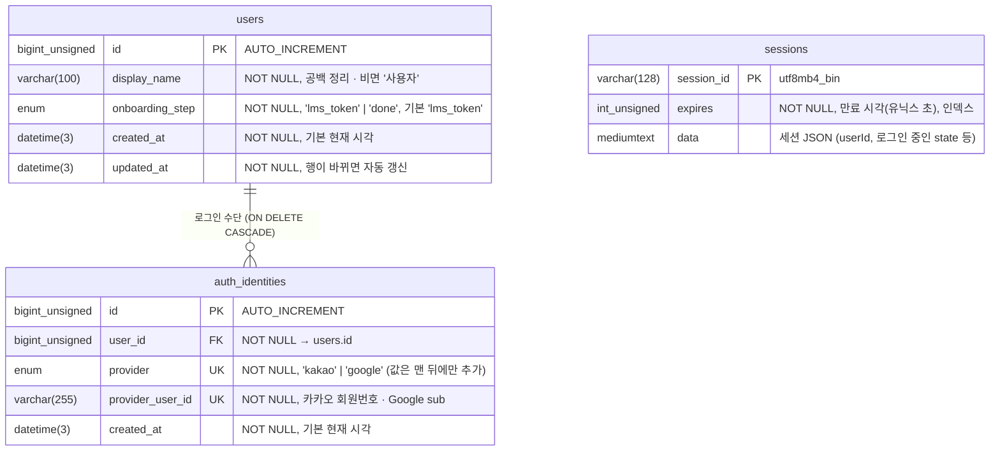

# ERD (백엔드 DB)

현재 마이그레이션(`migrations/0001` ~ `0005`) 기준으로 **실제로 있는 테이블만** 그린다. 마이그레이션을 추가하면 같은 커밋에서 이 문서도 고친다. 아직 만들지 않은 캘린더 · LMS 테이블은 넣지 않는다.

- 문자셋 utf8mb4, 시간 칼럼은 UTC로 저장 (`DATETIME(3)`, 밀리초까지)
- 마이그레이션 실행 기록 `schema_migrations`는 도구의 장부라 그리지 않는다

## 키 · 인덱스

| 테이블 | 이름 | 종류 | 칼럼 |
| --- | --- | --- | --- |
| users | PRIMARY | PK | `id` |
| auth_identities | PRIMARY | PK | `id` |
| auth_identities | `uq_auth_identities_provider_user` | UNIQUE (복합) | `provider`, `provider_user_id` |
| auth_identities | `idx_auth_identities_user_id` | 인덱스 | `user_id` |
| auth_identities | `fk_auth_identities_user` | FK | `user_id` → `users.id`, ON DELETE CASCADE |
| sessions | PRIMARY | PK | `session_id` |
| sessions | `idx_sessions_expires` | 인덱스 | `expires` (만료 세션 정리용) |

## 메모

- 한 사용자에 로그인 수단 여러 개(1:N). 같은 사람이라도 제공자가 다르면 지금은 별개 계정이다(계정 연결은 범위 밖).
- `UNIQUE(provider, provider_user_id)`: 같은 제공자의 같은 계정은 한 번만 등록된다. 동시 가입 때 중복을 막는 장치. 제공자가 다르면 같은 id 값도 다른 행이다.
- `sessions`는 `users`와 외래키로 묶여 있지 않다(세션 라이브러리 스키마). 사용자가 지워지면 `/api/auth/me` · `/logout`에서 확인해 세션을 지운다.
- `provider` ENUM 변경 이력: `('kakao')` → 0004 `('kakao', 'google')`. 다음 이메일 로그인에서 `'email'`을 맨 뒤에 추가할 예정.
- `provider_user_id` 길이 이력: `VARCHAR(64)` → 0005 `VARCHAR(255)` (Google sub 최대 255자, 이메일 최대 254자 예정).
