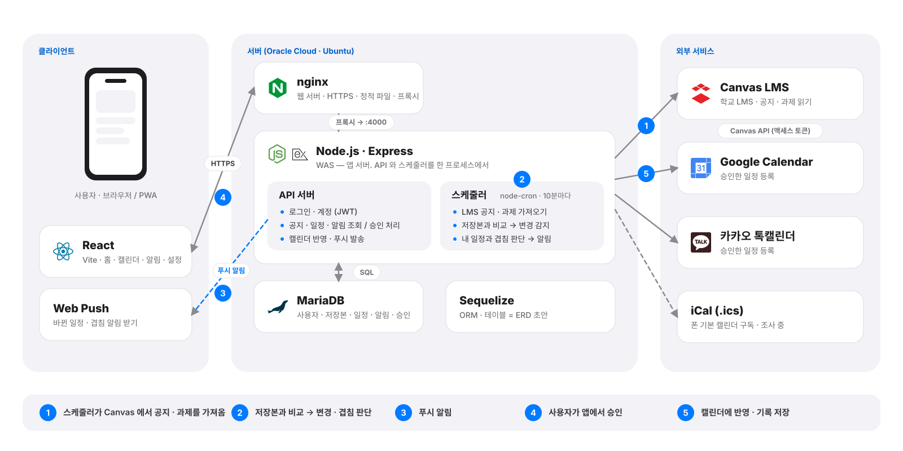

# 시스템 아키텍처

## 구성

| 구성 요소 | 기술 | 역할 |
|---|---|---|
| 프론트엔드 | React (Vite), React Router, Axios | 홈 · 알림 · 설정 화면. 일정 변경을 보여 주고 사용자의 승인 / 거절을 받는다. 푸시 알림을 받는다. |
| 웹 서버 | nginx | HTTPS 종단, 정적 파일(프론트엔드 빌드), `/api` 를 WAS 로 프록시 |
| WAS (앱 서버) | Node.js, Express, JWT, bcrypt, web-push | 로그인, 공지 · 일정 · 알림 조회, 승인 처리, LMS 토큰과 캘린더 연결 설정, 푸시 발송 |
| 스케줄러 | node-cron | 주기적으로 LMS에서 공지 · 과제를 받아 저장본과 비교하고, 바뀐 것이 있으면 내 일정과 겹치는지 판단해 알림을 만든다 |
| 데이터베이스 | MariaDB, mysql2 / Sequelize | 사용자, LMS 토큰, 공지 · 과제 저장본, 일정, 변경 이력, 알림, 승인 기록 |
| 외부 API | Canvas LMS API, Google Calendar API, 카카오 톡캘린더 API, iCal(.ics) | 학교 LMS 데이터 읽기, 승인된 일정을 캘린더에 반영 |

## 흐름

1. 스케줄러가 Canvas LMS API로 공지 · 과제를 가져온다.
2. 데이터베이스의 이전 저장본과 비교해 새 공지 · 바뀐 일정을 찾는다.
3. 바뀐 일정이 사용자의 기존 일정과 겹치는지 판단한다.
4. 알림을 만들고 푸시로 보낸다.
5. 사용자가 앱에서 확인하고 승인한다. 자동 반영은 하지 않는다.
6. 승인된 일정을 연결된 캘린더(구글 · 카카오 · iCal)에 반영한다.

## 정한 것 · 미정

- 일정 변경은 사용자가 승인해야 반영한다.
- iOS · Android 기본 캘린더는 iCal(.ics) 구독 주소 방식을 우선 검토 중. 더 알아보고 정한다.
- 세부 라이브러리는 개발 환경을 구성하면서 확정한다.
