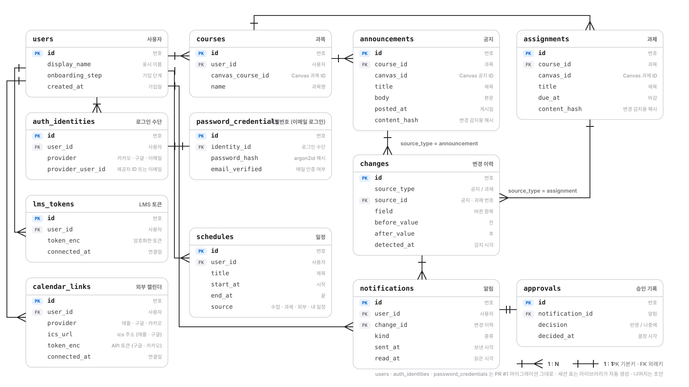

# ERD 설명 · 표마다 왜 있나

표 11개. "누가(users) → 무엇을 가져와(courses · announcements · assignments) → 무엇이 바뀌었고(changes) → 알리고(notifications) → 사용자가 결정하면(approvals) → 캘린더에 보인다(schedules)" 순서로 읽으면 된다.

## 계정

| 표 | 왜 있나 | 눈여겨볼 컬럼 |
|---|---|---|
| users | 로그인한 사람 한 명 = 한 행. 모든 데이터가 여기 매달린다. | display_name 카카오 · 구글에서 받은 이름. onboarding_step 가입 뒤 토큰 등록까지 했는지. 안 했으면 설정 화면으로 보낸다. |
| auth_identities | 한 사람이 카카오로도, 구글로도 들어올 수 있다. 로그인 수단을 users 에 넣으면 수단이 늘 때마다 컬럼이 늘어서 따로 뺐다. | provider + provider_user_id 가 유일. 같은 카카오 계정으로 두 번 가입되는 걸 막는다. |

로그인 세션 표(sessions)는 express-session 라이브러리가 만들고 관리해서 ERD에는 그리지 않았다.

## 연결

| 표 | 왜 있나 | 눈여겨볼 컬럼 |
|---|---|---|
| lms_tokens | Canvas 액세스 토큰은 그 사람의 LMS 전체를 열 수 있는 비밀값. users 에 섞지 않고 따로 두어 암호화해 저장하고, 해제하면 행만 지운다. | token_enc 암호화한 토큰. 평문 저장 금지. |
| calendar_links | 외부 캘린더는 한 사람이 여러 개(애플 + 구글) 연결할 수 있어 1:N. | provider 로 종류 구분. 애플 · 구글 ics 는 ics_url, 구글 · 카카오 API 는 token_enc. 둘 중 하나만 채운다. |

## LMS 에서 가져온 것

| 표 | 왜 있나 | 눈여겨볼 컬럼 |
|---|---|---|
| courses | 공지 · 과제는 과목에 속한다. 과목이 없으면 "어느 수업 공지인지"를 못 보여 준다. 사람마다 듣는 과목이 달라서 user_id 가 있다. | canvas_course_id Canvas 쪽 번호. 다시 가져올 때 같은 과목인지 맞추는 기준. |
| announcements | Canvas 공지 저장본. 변경을 알려면 "지난번에 뭐였는지"를 들고 있어야 한다. | content_hash 제목 · 본문 · 날짜를 합쳐 만든 해시. 다음 동기화 때 해시만 비교하면 바뀌었는지 바로 안다. |
| assignments | Canvas 과제 저장본. 공지와 분리한 이유는 과제에만 due_at(마감)이 있고 캘린더에 바로 들어가기 때문. | due_at 그대로 schedules 로 복사된다. content_hash 는 공지와 같은 용도. |

## 변경 · 알림 · 승인

| 표 | 왜 있나 | 눈여겨볼 컬럼 |
|---|---|---|
| changes | "무엇이 어떻게 바뀌었나"의 기록. 알림 문구와 화면의 전 → 후 표시가 여기서 나온다. 저장본을 덮어쓰기 전에 남긴다. | source_type + source_id 로 공지든 과제든 가리킨다. field 바뀐 항목(시간 · 장소 · 마감), before_value · after_value. |
| notifications | 사용자에게 보낸 알림 한 건. 변경 알림 말고 새 공지 · 새 과제 알림도 있어서 kind 로 구분한다. | change_id 변경 알림이면 어떤 변경인지. read_at 읽음 처리. sent_at 푸시 보낸 시각. |
| approvals | 사용자의 결정(반영 / 나중에). 알림과 1:1 이지만 따로 둔 이유는 "자동 반영하지 않는다"는 원칙의 증거이고, 결정 시각과 되돌리기를 남기기 위해서. | decision, decided_at. |

## 캘린더

| 표 | 왜 있나 | 눈여겨볼 컬럼 |
|---|---|---|
| schedules | 우리 캘린더 화면에 보이는 모든 것. 수업 · 과제 마감 · 외부 캘린더에서 읽어 온 것 · 직접 넣은 것이 한 표에 있어야 겹침 판단을 한 번의 조회로 할 수 있다. | source 출처. 외부 · 과제는 읽기 전용, 내 일정만 수정 · 삭제. start_at · end_at 으로 겹침 계산. |

## 흐름으로 보면

1. 설정에서 토큰 등록 → lms_tokens
2. 동기화가 courses · announcements · assignments 를 채우고, assignments.due_at 은 schedules(source = 과제)로
3. 다음 동기화 때 content_hash 가 다르면 changes 에 전 → 후를 남기고 저장본 갱신
4. changes 와 schedules 를 비교해 겹침을 판단하고 notifications 생성 · 푸시
5. 사용자가 반영을 누르면 approvals 에 기록하고 schedules 갱신
6. calendar_links 로 읽어 온 외부 일정도 schedules(source = 외부)에 들어와 겹침 판단에 쓰인다

초안이라 구현하면서 컬럼은 바뀔 수 있다. 바꾸면 이 문서와 erd.svg 를 같이 고친다.
