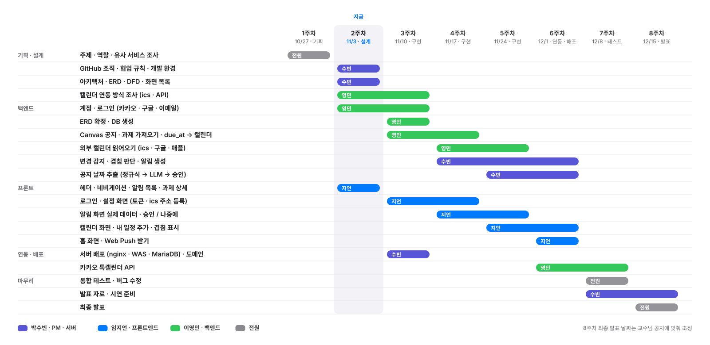

# 개발 일정

주차는 발표 요일(화요일) 기준. 11월 27일(목) 마감이라 5주 안에 끝낸다. 선택 항목은 시간이 남을 때만.

| 주차 | 단계 | 할 일 | 담당 |
|---|---|---|---|
| 1주차 | 기획 | 주제 · 역할 · 유사 서비스 조사 (전원) |
| 2주차 | 설계 | GitHub 조직 · 협업 규칙 · 개발 환경 (수빈) 아키텍처 · ERD · DFD · 화면 목록 (수빈) 캘린더 연동 방식 조사 (ics · API) (영민) 계정 · 로그인 (카카오 · 구글 · 이메일) (영민) 헤더 · 네비게이션 · 알림 목록 · 과제 상세 (지언) |
| 3주차 | 구현 | 서버 배포 (nginx · WAS · MariaDB) · 도메인 (수빈) 코드 리뷰 · PR 합치기 · 문서 갱신 (수빈) 계정 · 로그인 (카카오 · 구글 · 이메일) (영민) ERD 확정 · DB 생성 (영민) Canvas 공지 · 과제 가져오기 · due_at → 캘린더 (영민) 변경 감지 · 겹침 판단 · 알림 생성 (영민) 로그인 · 설정 화면 (토큰 · ics 주소 등록) (지언) 알림 화면 실제 데이터 · 승인 / 나중에 (지언) |
| 4주차 | 구현 · 연동 | 코드 리뷰 · PR 합치기 · 문서 갱신 (수빈) 변경 감지 · 겹침 판단 · 알림 생성 (영민) 공지 날짜 추출 (정규식 → 승인) (영민) 알림 화면 실제 데이터 · 승인 / 나중에 (지언) 외부 캘린더 읽어오기 (ics · 구글 · 애플) (지언) 캘린더 화면 · 내 일정 추가 · 겹침 표시 (지언) 홈 화면 · Web Push 받기 (지언) |
| 5주차 | 테스트 · 발표 | 코드 리뷰 · PR 합치기 · 문서 갱신 (수빈) 홈 화면 · Web Push 받기 (지언) 공지 날짜 LLM 보완 · 카카오 톡캘린더 API (영민) 통합 테스트 · 버그 수정 (전원) 발표 자료 · 시연 준비 · 최종 발표 (수빈) |

## 담당

- 박수빈 — PM · 서버: 환경 · 설계 문서 · 서버 배포 · 코드 리뷰 · 발표 자료
- 임지언 — 프론트 · 캘린더: 로그인 · 설정 · 알림 · 캘린더 · 홈 화면, 외부 캘린더(ics) 읽어오기, Web Push 받기
- 이영민 — 백엔드: 계정 · 로그인 · DB · Canvas 가져오기 · 변경 감지 · 겹침 판단 · 알림 생성 · 공지 날짜 추출
